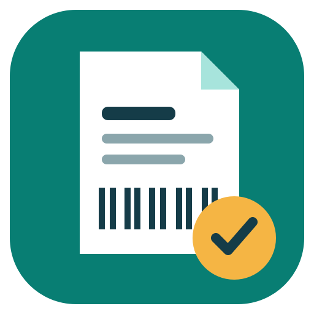
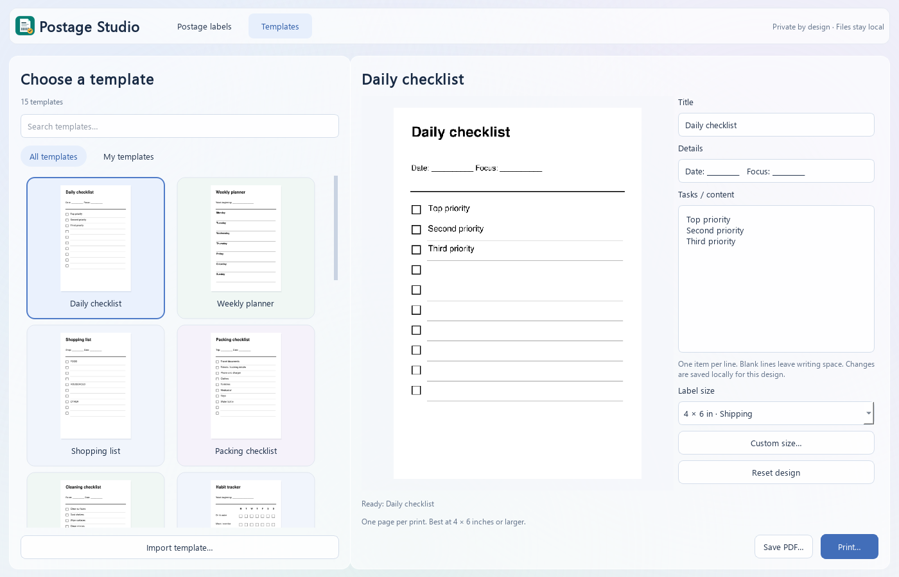

# Postage Studio



A Windows desktop app for extracting a postage label from a larger page, choosing its output size, and printing or saving it as a PDF.

## Download and run

Download the Windows package from [Releases](https://github.com/masterjobberman/postage-studio/releases). Extract the ZIP and open **Postage Studio.exe**. Python is not required for the packaged app. Windows 10/11, 64-bit is the intended platform; testing was performed on Windows 11.

The executable is unsigned, so Windows may display an unknown-publisher warning. Compare its SHA-256 checksum with the release checksums. This is an integrity check, not a guarantee that software is free of vulnerabilities.

## Use it

1. Open or drag in a PDF or image.
2. Select the page and let the app find the label.
3. Check the crop in the preview. Draw your own selection or rotate it if needed.
4. Choose a label size, then save a PDF or print through the Windows print dialog.

Match the printer's paper size to your selected size. Check the preview and barcode readability before using a printed label. Smaller output sizes can make shipping barcodes unreadable. This app extracts existing labels; it does not buy postage or create valid tracking numbers.

## Features

- Automatic label detection on larger pages, including A4.
- Manual crop selection and 90-degree rotation.
- Multi-page PDFs and multi-frame images.
- PDF, PNG, JPEG, TIFF, BMP, GIF and WebP input. Save other formats as PDF first.
- Proportional PDF export that preserves vector PDF artwork where available.
- Windows printing with the chosen page dimensions.
- Offline OCR to help orient image labels when Windows OCR language support is available.
- Saved custom sizes with millimetre/inch input and a reusable dropdown entry.
- A dedicated application icon.

### Included sizes

| Preset | Dimensions |
| --- | --- |
| 4 × 6 inch shipping | 101.6 × 152.4 mm |
| Metric shipping | 100 × 150 mm |
| A6 | 105 × 148 mm |
| 4 × 4 inch square | 101.6 × 101.6 mm |
| 4 × 2 inch address | 101.6 × 50.8 mm |
| 4 × 8 inch shipping | 101.6 × 203.2 mm |
| Brother shipping | 62 × 100 mm |
| Brother address | 62 × 29 mm |

Custom width and height can each be between 10 and 1,000 mm. Printer support varies. Preset names describe stock sizes and do not imply carrier or printer-manufacturer endorsement.

## Templates



Open the **Templates** tab, select a thumbnail from the gallery and edit its title, details and rows. Search by name or choose **My templates** to see your imports. The preview updates automatically. Use the shared label-size dropdown, then **Save template PDF** or **Print template**. Edits are remembered for each built-in design; **Reset this design** restores its defaults. Text that will not fit blocks printing until it is shortened.

All 15 designs are included: daily checklist, weekly planner, shopping list, packing checklist, cleaning checklist, habit tracker, project task list, order packing checklist, stock count sheet, storage box label, food freezer label, plant care label, equipment maintenance log, parcel handling label and thank-you insert. The thank-you insert optionally generates a QR code from text or a website address you enter.

Choose **Import my template** or drop a supported PDF/image onto the Templates tab. A private local copy appears under **My templates** and remains available after restarting, even if the original is moved. Select a page for multi-page imports. Imported artwork is not text-editable inside the app; edit its original file and import it again. Removing an import deletes only the library copy. Imports are limited to 50 MB and 50 pages; Word documents should be exported as PDFs first.

Designs are fitted proportionally to the selected stock. Most are intended for 4 x 6 inches or larger; smaller stock can make text or QR codes difficult to read. Inspect the preview before printing.

## Privacy

The application processes files locally and contains no upload, analytics, account sign-in or telemetry feature. Windows printing sends the selected label to your chosen printer, which may be a network printer. Exported PDFs remain where you save them. Custom sizes, template edits and the last selected size are saved in the local application-data folder under `Postage Studio/label-sizes.ini`. Imported templates are stored beside it in `Postage Studio/templates`. These personal files are not included in the source repository or release downloads.

This repository contains no real customer labels, addresses, tracking numbers or private test documents. Automated tests generate synthetic artwork. Do not attach real postage labels to public issues; barcodes can contain personal information even when visible text is hidden.

## Run from source

Use 64-bit Python 3.13 on Windows:

```powershell
python -m venv .venv
.\.venv\Scripts\python.exe -m pip install -r requirements.txt
.\.venv\Scripts\python.exe postage_app.py
```

## Build and test

```powershell
.\.venv\Scripts\python.exe -m pip install -r requirements-build.txt
.\.venv\Scripts\python.exe verify_sizes.py
.\.venv\Scripts\python.exe verify_inputs.py
.\.venv\Scripts\python.exe verify_templates.py
.\.venv\Scripts\python.exe collect_licenses.py
.\.venv\Scripts\python.exe -m PyInstaller --clean --noconfirm "Postage Studio.spec"
```

The executable is written to `dist/Postage Studio.exe`. Keep the licence notices with redistributed copies. Source is provided so users can inspect, modify and rebuild the application, including with replacement versions of its libraries. No restriction on reverse engineering for debugging library modifications is imposed.

The build excludes unrelated ICU DLLs discovered through PATH, which previously caused a QtCore DLL startup error. It uses the ICU supplied by supported Windows installations.

## Verification and limitations

Synthetic checks cover size validation, saved custom sizes, unit conversion, icon loading, PDF export dimensions and printing to a PDF device. These checks do not send a job to a physical printer. Detection is heuristic and can select the wrong region; always inspect the preview. Not every document format or carrier layout is supported. Password-protected PDFs must be unlocked first. Very large or malformed files may fail or consume substantial resources.

## Licence and support

Postage Studio is released under **GNU AGPL v3**; see [LICENSE](LICENSE). Its dependencies retain their own licences; see [THIRD_PARTY_NOTICES.md](THIRD_PARTY_NOTICES.md). This project is independent of postal carriers and printer manufacturers.

For ordinary bugs and feature requests, open an issue using a synthetic example. See [SECURITY.md](SECURITY.md) for vulnerability reporting and [CONTRIBUTING.md](CONTRIBUTING.md) for contribution guidance.
